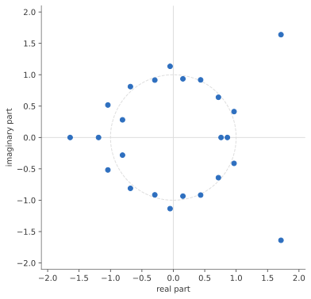

# CertPolySolve

CertPolySolve finds all the roots of a polynomial in one variable, and proves that it found them. You give it the
coefficients; it gives you every root, real or complex, each inside a small box that provably contains it. It is a
library for C and C++, built on [FLINT](https://flintlib.org).

The library was formerly called PolySolve.

## Install

You need a C++20 compiler (GCC 15 and Clang 21 are tested, MSVC too; the examples print with C++23's
`std::println`), CMake 3.20, and FLINT 3.6 or later with its thread support on, which is FLINT's default. Boost's
headers are needed only for the tests.

```sh
cmake -S . -B build/release -DCMAKE_BUILD_TYPE=Release -DFLINT_ROOT=/path/to/flint
cmake --build build/release --parallel 4
ctest --test-dir build/release
cmake --install build/release --prefix /path/to/prefix
```

Leave out `-DFLINT_ROOT` when FLINT is installed system-wide. From CMake, `find_package(CertPolySolve)` and link
`CertPolySolve::certpolysolve`.

## A first solve

```cpp
#include <certpolysolve/certpolysolve.hpp>
#include <print>

int main() {
    const certpolysolve::Polynomial p{-2, 0, 1}; // constant term first: x^2 - 2
    std::println("p(x) = {}", p);
    const certpolysolve::Result result = certpolysolve::solve(p);
    if (!result.ok()) {
        std::println(stderr, "{}: {}", result.stop(), result.message());
        return 1;
    }
    for (const certpolysolve::Root &root : result.roots())
        std::println("{}", root); // the centre of a box proved to hold one root
}
```

```
p(x) = x^2 - 2
-1.4142135623730951
1.4142135623730951
```

The same roots in C come from [this program in the guide](docs/api.md#approximations). The command-line tool does
the same from a shell: `certpolysolve_cli -2 0 1`.

## What you get



*The 24 roots of x²⁴ − x²³ − x²² + 9x²¹ + … + 9, as the solver returns them with the defaults. Each dot is the centre
of a box proved to hold exactly one root; the boxes are between 5·10⁻¹⁸ and 2·10⁻¹⁷ wide, too small to draw.*

- **Every root, and a proof.** The answer is a list of boxes in the complex plane. Each box provably holds a known
  number of roots, and together they hold all of them. Nothing is estimated; a root cannot be missed or invented.
- **The accuracy you ask for.** By default every root is correct to 15 digits (53 bits). Ask for 1,000 digits and
  you get 1,000 digits; the solver raises its own working precision as far as it needs.
- **Plain numbers when you want them.** `result.values()` is the roots as `std::complex<double>` once the goal is
  met. Repeated roots appear as many times as their multiplicity, which the solver proves. (A
  `std::complex<double>` has no `std::format` support before C++26: print `z.real()` and `z.imag()`, or print the
  `Root`, which formats.)
- **Real roots only**, on request, each in an interval proved to hold it.
- **Exact input.** Coefficients can be integers of any size, fractions such as `"1/3"`, decimals, or doubles taken at
  their exact value. A polynomial of degree one million with three terms is three terms, not a million.
- **It says when it stops.** A time limit, a cancellation or a precision cap stops a solve, and the result still
  holds proved boxes and says why it stopped.

## How fast

On our test set of about 3,500 polynomials, with the defaults on one core, a solve typically took 0.02 s below
degree 256, nine in ten under 0.06 s; a fifth of a second from 256 to 1,023; half a second from 1,024 to 4,095; and
four to six seconds above. The slowest are polynomials whose roots lie extremely close together, such as Mignotte's
with coefficients of tens of thousands of bits, which take seconds to minutes at any degree. A dense polynomial of
degree 24,576 solves in 16 seconds on one core and 11 on eight. Run time grows about linearly with the degree over
this range ([how it works](docs/how-it-works.md#how-fast) has the table).

## Built on

FLINT supplies the arbitrary-precision and ball arithmetic, and the exact algebra, including the proofs that a
polynomial has no repeated roots. The root finding is CertPolySolve's own: three methods that the solver chooses among.
The *secular* method follows MPSolve (Bini, Fiorentino and Robol); the *piecewise* method follows Guillaume
Moroz's PWPoly; the *classical* one is the Aberth–Ehrlich iteration. The notices of the implementations we
consulted are in [licenses/](licenses/).

## Where next

- [The quick start](docs/quickstart-cpp.md): five short programs for the common tasks.
- [Examples](examples/README.md): more programs, by topic.
- [How CertPolySolve works](docs/how-it-works.md): the ideas in two pages, for anyone curious.
- [The guide](docs/api.md): every function, in C and C++.
- [The changelog](CHANGELOG.md).

## Status

This is version 0.5.1, the first under the name CertPolySolve; version 0.5.0 was released as PolySolve.
The [changelog](CHANGELOG.md) lists the changes.

0.5.1 is tested on Linux with GCC and Clang; 0.5.0 was also tested on Windows with MSVC. macOS is untested. The C and C++
interfaces ship today; Python and Julia packages come later. Before 1.0 a release may change the API.

CertPolySolve is free software under the GNU Lesser General Public License, version 3 or (at your option) any later
version, the same licence as FLINT: see [COPYING.LESSER](COPYING.LESSER) and [COPYING](COPYING). The copyright
holders are listed in [AUTHORS](AUTHORS). FLINT, GMP and MPFR are separate libraries under their own licences.
