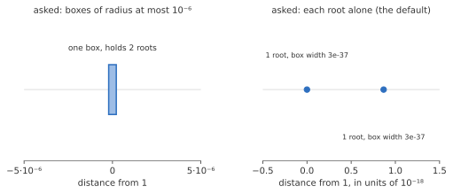
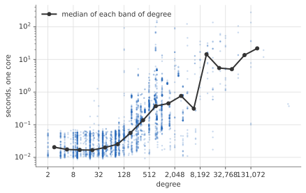

# How CertPolySolve works, in two pages

This page tells the whole story once, without proofs, for anyone who wants to know what the solver does with a
polynomial before trusting its answer. The details are in [the mathematics](mathematics.md) and
[the methods](production-methods.md); [the glossary](glossary.md) maps the words used here to the library's own.

## The promise

CertPolySolve takes a polynomial and returns a list of rectangles in the complex plane, each with a proved count: this
rectangle contains exactly one root, that one exactly four. The rectangles are disjoint and the counts add up to
the degree, which is what proves that every root has been found and none twice. You say what kind of answer you
want. The default is each root alone in a rectangle of relative size 2⁻⁵³, about 15 decimal digits, with its
multiplicity proved. You can instead accept small clusters of roots with a count, ask only about the real roots, or
ask for rectangles of a fixed size. When the solver runs out of precision, work or time, it does not guess. It
returns the rectangles it has proved, says that the goal was not met, and says why.

*The polynomial (x − 1)(x − 1 − 2⁻⁶⁰)(x + 1) has two roots about 10⁻¹⁸ apart. Asked for boxes of radius at most
10⁻⁶, the solver returns one box near 1 that provably holds two roots. Asked for each root alone (the default), it
raises its working precision to 335 bits and returns two boxes, each 3·10⁻³⁷ wide. Both answers are correct; they
answer different questions.*

## Proofs from arithmetic

Every proof is an inequality between numbers that cannot be computed exactly, so the solver computes with *balls*:
a midpoint and a radius that is guaranteed to contain the true value. If two balls separate, the inequality is
proved. If they overlap, nothing is known, and the computation can be repeated with more bits. With exact
coefficients the radii shrink as the working precision grows, so precision is a dial the solver turns when a proof
fails for lack of bits. It keeps the dial as low as it can.

The inequalities come from one theorem of complex analysis, Rouché's, in three forms. If one term of the Taylor
expansion of p about a point dominates all the others on a circle, the disk inside holds exactly that many roots.
If the linear term dominates, the disk holds exactly one root, and that test needs only p, p′ and a bound on p″ at
the point. And a disk of radius n·|p(c)/p′(c)| about any point c holds at least one root; n such disks that do not
overlap hold exactly one root each. Two helpers complete the kit. Squaring the roots (Graeffe's transformation)
makes a dominance visible when the plain coefficients hide it, and a count in a disk becomes a count in the square
around it by counting a second disk of twice the radius.

## Finding candidates

Proofs are cheap at a good point and impossible at a bad one, so most of the work is finding good points. Newton's
method finds one root. The Ehrlich–Aberth iteration runs n Newton iterations together, with a repulsion term that
keeps them from converging to the same root; started on circles that the sizes of the coefficients suggest, it
converges for most polynomials in a few dozen sweeps. The solver's first pass is just that, in ordinary
double-precision arithmetic, followed by a certificate at each point. On an easy polynomial that pass is the whole
solve.

When it is not, the solver changes how it holds the polynomial. The coefficients are a bad representation near a
root, where evaluation cancels. The *secular* representation, which CertPolySolve takes from MPSolve, describes p by n
nodes and n residues; it is exact for any choice of distinct nodes and well behaved when the nodes are near the
roots. The iteration runs on it, the residues give a free cover of disks with proved counts, and the representation
is rebuilt whenever the nodes have drifted. For polynomials of very high degree the solver instead covers the plane
by rings and, on each piece of a ring, replaces p by a short *local model* with a proved error bound, built for all
the pieces at once by fast Fourier transforms; this is Moroz's piecewise method. The model's roots are the
candidates, and a certificate for the model that leaves room for its error is a certificate for p.

## Hard inputs

Clusters of close roots slow everything down: the iteration crawls, the coefficients cancel, and the precision must
climb. Three tools help. A root count by the winding number of the secular representation around a circle says how
many roots a disk really holds, even when the candidates are distributed wrongly among clusters, and it runs in
double precision. A restart finds a cluster's size and centre by such counts, builds a short model of the polynomial
at the cluster's own scale, and uses that model's roots as new candidates. And a ledger of proved regions, kept apart
from the moving candidates, means that proof work is never repeated: a region proved to hold exactly k roots stays
proved when the models are rebuilt and the precision changes.

Before any of this, exact arithmetic does what it can. Denominators are cleared, roots at zero are divided out, a
bound on the roots is computed, and the polynomial is split into square-free factors. That split is the only way the
solver ever learns a multiplicity: a cluster of four roots and a root of multiplicity four look identical to every
numerical test, and the exact factorisation tells them apart.

## Deciding

Exact inputs of degree 1 to 4 skip the choice: the closed forms answer them, with the discriminant
computed exactly to tell a multiple root from distinct ones, and real from nonreal roots of real input. For everything else, a selector reads the input and chooses between the
secular route and the local-model route by a cost estimate
computed in exact integers, so the choice is the same on every machine. The secular route can engage a certified
subdivision search alongside its numerical iteration. The work budget accounts for both searches; a resource stop
returns the certified information obtained so far. Starting subdivision conditionally does not promise a bounded
delay to accuracy for every input. Whichever route answers checks its certificates against the original input, so a poor
choice can cost work without making an uncertified candidate into a valid answer.

## How fast

Measured on our test set of about 3,500 polynomials, with the default settings on one core:

*Each dot is one solve; the line joins the medians of the bands of degree. The spread at a given degree is the
other factor, how close the roots are to each other. Above degree 8,000 the set is small and mixed, which is why the
medians there jump.*

| Degree | Typical solve | Nine in ten under |
|---|---:|---:|
| below 256 | 0.02 s | 0.06 s |
| 256 to 1,023 | 0.22 s | 2.1 s |
| 1,024 to 4,095 | 0.55 s | 3.5 s |
| 4,096 to 16,383 | 4.1 s | 26 s |
| 16,384 and up | 5.5 s | 56 s |

Run time grows about linearly with the degree over this range; the other factor is the precision the roots need,
which is set by how close they are to each other. A dense polynomial of degree 24,576 solves in 16 seconds on one
core and 11 on eight. A polynomial of degree one million with three terms is three terms to the solver: its real
roots are found in under half a second, and all its complex roots in about a minute.

## What CertPolySolve is built on

FLINT supplies the arbitrary-precision and ball arithmetic and the exact algebra. The three root-finding methods
are CertPolySolve's own implementations of ideas from the literature: the secular representation and its iteration
follow MPSolve (Bini, Fiorentino and Robol), the local models follow PWPoly (Guillaume Moroz), and the classical
method is the Ehrlich–Aberth iteration. The certificates are Rouché's theorem as stated above. A book-length account,
*How CertPolySolve Works*, is in preparation.
