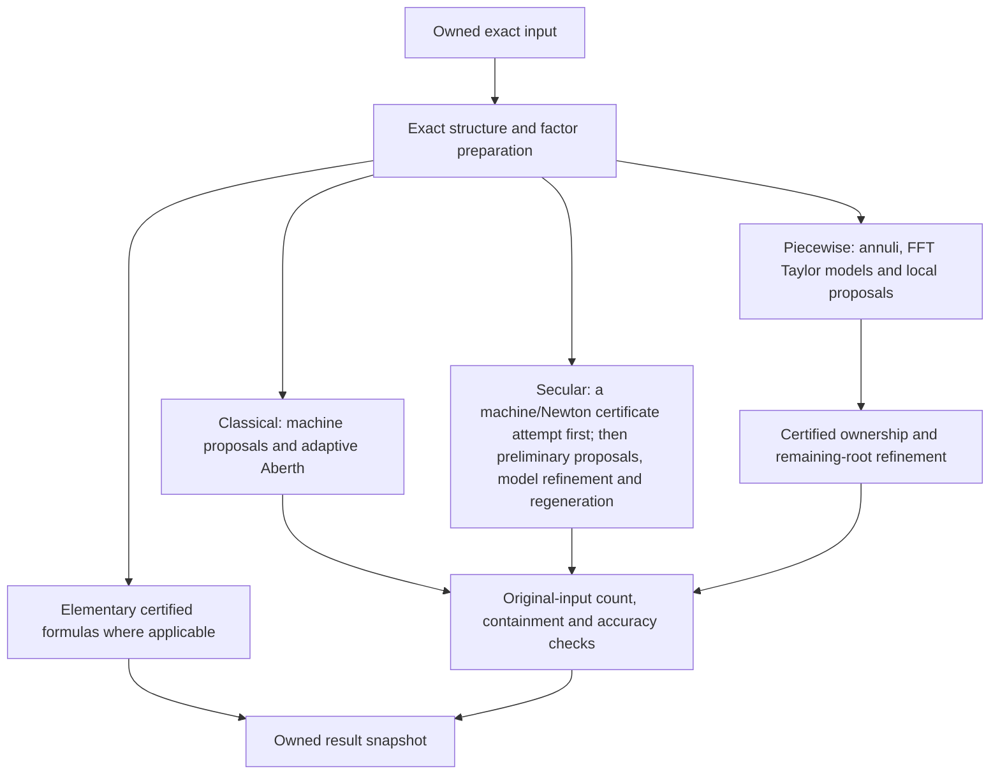

# Supported methods and ownership

The C++ field `Options::method` (`certpolysolve::Method::automatic`, `classical`, `secular`, `piecewise`) and the C
setter `cps_options_set_method` (`CPS_METHOD_AUTO`, `CPS_METHOD_CLASSICAL`, `CPS_METHOD_SECULAR`,
`CPS_METHOD_PIECEWISE`) choose the method. The CLI spelling is `--method classical` (likewise for the other names).
`CPS_METHOD_AUTO`, the default, is the selector described below. Explicit methods use the maintained numerical
recipes, not the older baseline experiment configurations.

```cpp
certpolysolve::Polynomial p;
p.set(0, "-2").set(3, "1"); // x^3 - 2
auto result = certpolysolve::solve(p, {.goal = certpolysolve::Goal::approximation(), .method = certpolysolve::Method::secular});
```

What each query gets ([api.md](api.md#7-solving) has the full tables; a usage error is `CPS_INVALID_ARGUMENT` from
the solve, a refusal `CPS_UNSUPPORTED_QUERY` in the result):

| Input / query | Auto | Explicit methods |
|---|---|---|
| Exact coefficients, all complex roots, accuracy or approximation | eligible degrees 1–4: a closed-form attempt; otherwise, or if that attempt cannot finish, the selector chooses secular or piecewise | all three |
| Exact coefficients, all complex roots, cluster radius | the selector, as for accuracy | usage error |
| Exact coefficients, all complex roots, isolation | exact preparation and native subdivision, without a width target | usage error |
| Ball coefficients, all complex roots, accuracy, approximation or cluster radius | the D5 recipe | refusal (cluster radius: usage error) |
| Ball coefficients, isolation | refusal | usage error |
| Coefficients, real-only | exact real input: the sparse recursion, the axis charts, then the complex route; ball or nonreal input: refusal | usage error |
| Native secular equation, all complex roots, accuracy, approximation or cluster radius | the D5 recipe, on the terms | secular: answered (cluster radius: usage error); classical, piecewise: usage error |
| Native secular equation, isolation | usage error | usage error |
| Native secular equation, real-only | the exact numerator, exact real isolation | usage error |
| Program, all complex roots, any goal but isolation | the structured route on the program's evaluations, in Aberth mode | classical: Aberth mode; secular: secular mode; piecewise: usage error |
| Program, real-only, isolation goal or region | usage error | usage error |

An explicit method names the principal numerical method. Exact factorization,
zero/power reductions, direct elementary formulas, internal candidate stages,
and original-source finishing remain legitimate parts of that method. There is
no automatic chain trying every research algorithm.

## The selector

Before the selector, exact coefficients of degree 1 to 4 with an all-complex query, the accuracy or approximation
goal and no region are answered by
the closed forms (`src/small_degree.cpp`, `src/small_degree_forms.cpp`): -b/a; the stable quadratic formula (the
larger root from -(b ± sqrt D)/2, the other by Vieta); for a cubic, Viète's trigonometric form when its coefficients
are real and its three roots real, the real form of Cardano's formula when one root is real, and Cardano's formula
for complex coefficients; for a quartic, the biquadratic as a quadratic in x^2 (after the shift that removes the
cubic term), otherwise Descartes' two quadratic factors from a root of the resolvent cubic, and for real coefficients
with a multiple root the exact square-free factorization. All run in ball arithmetic at doubling precision. A quartic
with complex coefficients and a multiple root takes the general route. The discriminant is computed exactly (for
the cubic, the invariants D0 = b^2 - 3ac, D1 = 2b^3 - 9abc + 27a^2 d and D1^2 - 4 D0^3 in integers, and their
analogues for the quartic), so a multiple root
is one region with its exact multiplicity, the roots of real input are proved real or not real exactly, and exact
zero roots are set apart first. A real-only query reaches these forms through the complex route's nested solve. Where
the closed forms do not meet the goal within the precision cap, or a value is beyond the exact storage policy, the
selector routes as below.

Public Auto is the selector of `src/solve/auto_selection.cpp`. It reads the input and the
query only, never names, hashes or family labels:

- Exact coefficients with an all-complex accuracy or approximation goal go to the maintained
  secular recipe, or to the maintained piecewise recipe when piecewise's own work estimate (its admission, with
  its development caps lifted) is below the global candidate stage's minimum sweep budget. A goal below the
  library's default is judged at the default. A precision cap below piecewise's first working precision keeps
  the secular recipe.
- Exact coefficient queries with a cluster-radius goal take the maintained secular recipe.
  Piecewise admission currently refuses that goal.
- When it picks piecewise and the estimate is at least the golden ratio times the cost bound of the global
  recipes' certificate attempt (a binary64 packet and two evaluation passes), the piecewise recipe begins with
  that attempt. A forced piecewise solve never does. This is an empirical ordering rule;
  the cost estimate and attempt allowance do not establish a worst-case competitive ratio.
- On exact real coefficients, a factor of degree at least `heuristics::real_line_seed_min_degree` whose roots are
  all real starts from the all-real seed pass's seeds instead of the circles (`src/real_line_seeds.cpp`,
  the design), on the secular route and on piecewise's hand-off to it.
  Where the selector chose piecewise for the accuracy or approximation goal on a dense input, the seeded secular
  route is taken instead when the pass seeds every root of the input's primitive polynomial (`every_root_seeded`,
  the note). The seeds only start the iteration; the secular route
  certifies every root.
- Every comparison above is of exact integer counts or of binary64 ratios, so the route is the same on every
  platform (the note).
- A forced piecewise solve leaves for secular as the selector's piecewise route does where the selector would
  choose piecewise (at the selector's estimate), and elsewhere once its counted work passes a global solve's
  minimum budget, `initial_sweep_allowance` global sweeps priced in binary64 operations
  (`PiecewiseRootConfig::caller_method`). Its certificates do not transfer: secular solves the original input within what is
  left of the call's work budget.
- A real-only query on exact real coefficients goes to the real-only route (`src/real_only_route.cpp`): first,
  under a work budget of at least 64 units a root, the sparse recursion where its predicted cost is below that
  of the route the selector would take for the complex query (B6,
  the note), and the piecewise method's axis charts where the selector
  would choose piecewise (the note); then the complex route, whose regions
  proved real are the answer. Each attempt that stops hands the query on, its work counted.
- Inexact coefficients and native secular input keep the older D5 recipe (`production_policy`), and so does
  secular input's real-only query, through its exact numerator and the exact real isolation.
- A program has no selector: Auto takes the classical recipe's Aberth mode on the program's evaluations.

The choice is not part of the API's contract. Its design and measurements are in
the selector campaign and its findings; the
queries that stayed on D5 are discussed in the D5 route note.



The secular recipe first tries classical's bounded
binary64 Aberth run plus an original-source Newton certificate
(`machine_newton_cover`) on every source; a failed attempt whose machine run
converged hands its points to secular's preliminary phase, as hints only.
Classical has always made this attempt. See
method-composition-design-20260928.md.

After exact factor preparation, Auto's global route for direct exact-coefficient
all-complex queries starts with numerical refinement. When a factor increases precision and still
has an unresolved certified cluster, its subdivision search starts from the
retained cover. The two searches take turns on the same thread. Subdivision
receives a target one-eighth share of estimated arithmetic work; this is not a
fixed fraction of elapsed time. Local numerical solves retain their own
subdivision fallback.

One internal work and precision allowance covers the whole numerical attempt,
including its local solves and accompanying subdivision. Once it is exhausted,
the admitted operation finishes and the complete subdivision search receives
exclusive service. Fine certified regions remain available for publication;
the complete search can normalize its starting geometry to one containing
square. The caller's work, precision, memory and cancellation limits still
apply. Explicit methods, native secular input and staged piecewise, program and
real wrappers use their own scheduling rules. Standalone exact complex isolation
starts complete subdivision immediately. When the input exceeds the exact
preparation allowance, Auto retains the general counted-cover schedule; that
case does not satisfy the prepared-factor progress/bound premises. The
[mathematics](mathematics.md#persistent-certified-subdivision-and-contraction)
separates certified output, eventual attainment and modeled work.

Forced piecewise hands every stop that is not the caller's (its regime exit, a
storage refusal, coefficient exponents beyond its working range, its precision
budget) to the secular recipe on the original input, within the same call and
work budget; `cps_result_handoff` reports it. A spent work budget, the time limit
and a cancellation stay with piecewise.

Every solve is one call (the API has one-shot solves only;
[api.md](api.md#7-solving)). No caller code runs during a solve:
the time limit and the cancellation token are read at the solver's
checkpoints. Piecewise keeps exact preparation, factor solvers, cross-factor
separation requests and multiplicity restoration for the solve. Preparation is
charged as one work unit, and factor work is shared within the remaining
allowance. Work-limited solves rotate among factors.

An exception after numerical work begins ends the solve with
`CPS_INTERNAL_ERROR` (`CPS_OUT_OF_MEMORY` for an allocation failure); no partial
result is published from the failed call, and already returned results remain
owned values. This is an explicit integrity guarantee, not a promise that
FLINT's allocator can recover from every system allocation failure.

## Code and build boundaries

- Shared committed preparation descriptions: `src/prepared_structure.hpp`.
  These on-demand owned snapshots distinguish applied power substitutions,
  factor multiplicities and proof status. They inspect existing owners; public
  dispatch does not yet transfer a single shared preparation between methods.
- Compressed-coefficient modular square-freeness proof: `src/modular_squarefree.cpp`.
  Complex exact preparation shares this cheap first proof and retains the
  extension-field and exact-decomposition fallbacks in `src/exact_complex.cpp`.
- The C entry points, their argument checks, the usage errors and the regions' order: `src/c_api.cpp`.
- Public dispatch (the method table, the selector's route, the piecewise-to-secular hand-off) and the
  exception boundary of a solve: `src/session.cpp`; the selector: `src/auto_selection.cpp`; the real-only route:
  `src/real_only_route.cpp`.
- Classical/secular work, and the program route (`SolveState::program_advance`): `src/solver.cpp`.
- Program input: `src/program*.{hpp,cpp}`.
- Piecewise factor ownership and original-input assembly: `src/prepared_piecewise.cpp`.
- Mathematical kernels and checked FLINT adapters remain in `src/`.
- Dense/structured companion, old portfolio and JIT implementations are research code, not part of
  this repository.

The optional bounded-error FFT (BEFFT) never shipped, and its support is
removed.
No FLINT root solver is used by a public method.
