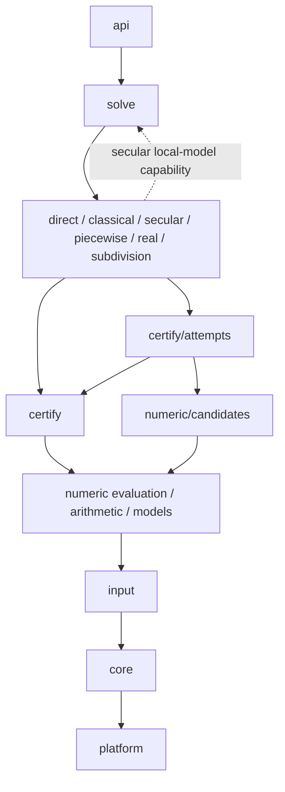
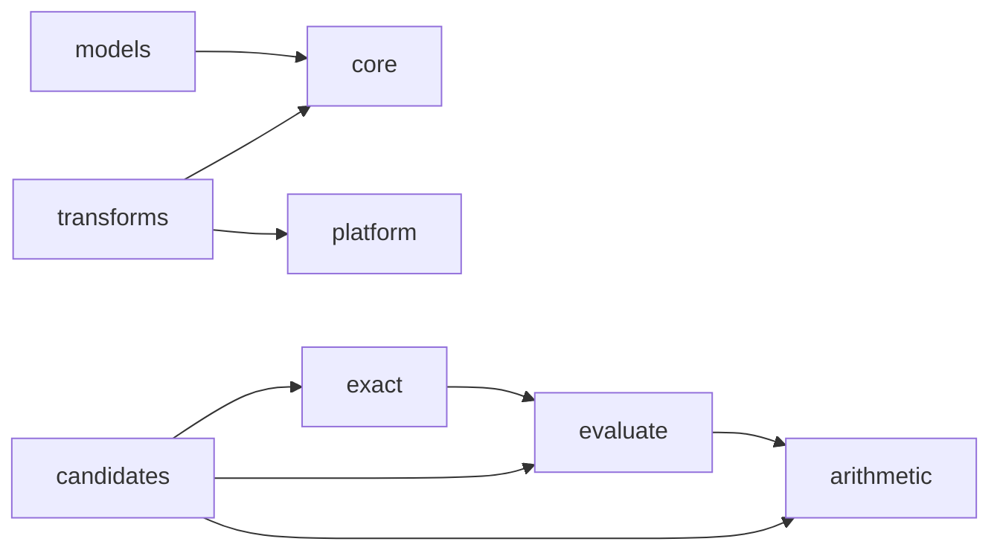

# Source map

The installed product is one `libcertpolysolve`: the C ABI in
`include/certpolysolve/certpolysolve.h` and the header-only C++ wrapper in
`include/certpolysolve/certpolysolve.hpp`. Everything here is private. FLINT supplies
arithmetic, exact algebra and low-level inclusion predicates; root solving is
native. Candidate points and local-model roots are proposals. Only original-source
certificates, or proved exact maps of them, justify published regions.

## Directory and dependency structure

```text
src/
  api/                  C entry points, argument checks and error boundary
  solve/                query dispatch, preparation, recipes and handoffs
  methods/
    direct/             small-degree closed forms
    classical/          classical isolation and refinement
    secular/            secular iteration, regeneration and restarts
    piecewise/          charts, proposal management, ownership and rounds
      axis/             piecewise work restricted to the real axis
      finishing/        original-source finishing of piecewise proposals
    real/               real isolation and sparse derivative recursion
    subdivision/        the complete subdivision method
  certify/              inclusion/count proofs, cover operations and exact lifting
    attempts/           shared Newton/program repair, precision retries and cover attempts
  numeric/
    arithmetic/         arithmetic adapters and polynomial operations
    evaluate/           coefficient, secular and program evaluators
    exact/              bounded exact preparation, factors and structural maps
    candidates/         numerical point generation and iteration kernels
    models/             local model values, error bounds and restriction
    transforms/         fixed-point and ball transform support
  input/
    coefficients/       exact compressed coefficients and sparse terms
    secular/            native secular-equation representation
    program/            owned program graph and parsing
  core/                 values, RAII ownership, contracts and resource accounting
  platform/             parallel work and floating-point environment
  internal.hpp          convenience include for tests/tools only
```

Dependencies point from API to orchestration, from orchestration to methods, and
from methods through certification and numerics to input/core/platform support.
A module may directly use the lower services it needs. Methods do not include
each other or the controller. Numerical code does not publish roots or depend on
method state. Each `numeric/` subdirectory has its own manifest owner and private object target.
Their dependencies are checked separately; the installed library stays whole.
Within evaluation, `monic_source.hpp` is the abstract polynomial contract;
`structured_source.hpp` owns coefficient/native source implementations and caches.
Proofs and program evaluation can use the former without importing the latter.
`certify/attempts` also has its own owner, `certify_attempts`: it may improve
proposals and invoke proofs, while `certify` cannot use candidate generators or
the attempt strategies. The compensated strategy lives with attempts because
it also owns a double-double Aberth repair loop.

[modules.json](modules.json) assigns every production and research source/header
an owner, declares cross-module interfaces, and supplies the private CMake object
targets. The boundary checks check every include
branch and, on Linux, strong internal references in the actual production objects.
The installed target remains `CertPolySolve::certpolysolve`. Default-off experiments stay
under `research/solvers`, owned by the same logical modules as their counterparts.

## Dependency overview

Solid arrows mean a module depends on another; direct uses of lower-level
services are omitted. The dashed edge is an explicitly supplied runtime call,
not a source dependency. The concrete edge lists are checked from `modules.json`.



The six method modules are siblings: one cannot include another. Public headers
and the test/tool compatibility include are two additional manifest owners.
Most internal declarations remain in `certpolysolve::detail`; file ownership,
private interfaces and object-symbol checks enforce the boundaries. Piecewise's axis and finishing subdirectories share its method module. The bounded
runtime capability is detailed below.

Within `numeric`, the enforced dependencies are:



Direct uses of input/core/platform support by the first four modules are omitted.
Exact program preparation reuses traversal and arithmetic interpretations from
evaluation; evaluators do not depend on exact preparation or candidate state.
Models hold local value/error operations, while transforms provide fixed-point
and ball transforms. Research files follow the same ownership rules. The symbol
check covers strong compiled references, not all inline/template or runtime calls.

## A call

```text
api/c_api.cpp
  └─ solve/session.cpp: SessionState, one advance per public call
       ├─ QueryExecution: validate, resolve defaults, latch cancellation
       ├─ RealOnlyRoute: exact-real Auto queries
       │    ├─ sparse derivative recursion
       │    ├─ piecewise axis attempt
       │    └─ solve_complex_query: a fresh complex solve for each refinement
       └─ ComplexQueryState: ordinary engine dispatch and handoffs
            ├─ direct small-degree attempt
            ├─ auto_selection: choose a maintained route
            ├─ PreparedPiecewiseState: exact factors → piecewise engines
            │    └─ a nonfinal stop may hand off to a fresh secular SolveState
            └─ SolveState: coefficient, native secular or program driver
                 ├─ bounded preparation and per-factor state
                 ├─ classical/secular numerical work
                 └─ scheduled subdivision; complete service where the selected policy enables it
```

`QueryInput` owns the input or borrows immutable C API terms for the synchronous
call. `QueryExecution` owns the cancellation latch and cannot be moved or copied.
`ComplexQueryState` borrows a `QueryInput` that outlives it. The real-only route
calls the fresh complex entry directly; it does not construct another session.
Stateless real-query predicates, nested options and region setup live in
`solve/real_query.*`, independent of either route's state.

The ordinary driver also handles D5's legacy real/native-secular cases; the
real-only Auto orchestration applies only to the exact-real coefficient queries
specified in [production methods](../docs/production-methods.md). Programs use the
classical or secular recipe, without the coefficient selector.

For eligible direct prepared exact-coefficient global Auto, the shared
[factor controller](solve/factor_state.cpp) runs the delayed 1/8 race and owns
complete-service transitions. The query-wide [heuristic allowance](core/heuristic_budget.hpp)
is shared with synchronous local solves and is never renewed by a factor,
restart or warm entry. [Policies](solve/policies.hpp) distinguish that path from
legacy/forced and staged piecewise/program/real paths. Standalone exact complex
isolation uses the same [subdivision engine](methods/subdivision/subdivision.cpp)
with complete service immediately. This is one engine with different entry and
stopping policies, not a second isolation implementation. See the
guarantee chapter for its model scope;
piecewise local-model completeness and its whole-route cost remain separate work.

## Responsibilities and interfaces

| Concern | Start here | Boundary |
|---|---|---|
| Public call and result | [api/c_api.cpp](api/c_api.cpp), [solve/session.cpp](solve/session.cpp) | Public validation/error translation surrounds private query execution. |
| Machine conversion | [numeric/arithmetic/machine_conversion.hpp](numeric/arithmetic/machine_conversion.hpp) | Convert FLINT midpoints and machine values with explicit rounding and nonzero checks; coefficient preparation stays in candidates. |
| Taylor remainder bounds | [numeric/evaluate/polynomial_remainder.hpp](numeric/evaluate/polynomial_remainder.hpp) | Own second-derivative magnitudes; borrow coefficients only during construction, without retaining the polynomial or solver state. |
| Program evaluation | [numeric/evaluate/program_machine.hpp](numeric/evaluate/program_machine.hpp) | Batched values, derivatives and noise estimates, independent of candidate sweep state. |
| Program candidate iteration | [numeric/candidates/program_candidates.hpp](numeric/candidates/program_candidates.hpp) | Jacobi Aberth sweeps, range fallback and stopping; proposed points still need original-input certificates. |
| Query envelope | [solve/query_execution.hpp](solve/query_execution.hpp), [solve/query_input.hpp](solve/query_input.hpp) | Own defaults and cancellation lifetime; no numerical engine state. |
| Recipes and work handoffs | [solve/policies.hpp](solve/policies.hpp), [solve/complex_query.cpp](solve/complex_query.cpp) | Orchestration chooses recipes; `core/engine_policy.hpp` holds their shared configuration data. |
| Whole-input preparation | [solve/prepared_piecewise.hpp](solve/prepared_piecewise.hpp), [solve/solve_state_impl.hpp](solve/solve_state_impl.hpp) | Exact factors and coordinate maps precede engines on individual factors. |
| Global query phases | [solve/solver_advance.cpp](solve/solver_advance.cpp), [solve/factor_pass.hpp](solve/factor_pass.hpp) | Input preparation, factor scheduling, overlap repair and final publication; numerical factor steps and assembly stay in `solve/solver.cpp`. |
| Secular model lifecycle | [methods/secular/secular_model.cpp](methods/secular/secular_model.cpp) | Compare the retained model, refresh its residues and certify it before growth; the caller owns whole-step work accounting. |
| Secular precision growth | [methods/secular/secular_growth.cpp](methods/secular/secular_growth.cpp) | Distinguish input floors from precision limits; resume candidate restarts without charging precision twice. |
| Secular packet lifecycle | [methods/secular/secular_packets.cpp](methods/secular/secular_packets.cpp) | Dispatch binary64, mixed or multiprecision packets, adopt proposals and schedule refresh; keep whole-step accounting in the caller. |
| Secular local solve | [numeric/candidates/local_model_solver.hpp](numeric/candidates/local_model_solver.hpp), [solve/local_model_solver.cpp](solve/local_model_solver.cpp) | Required stateless synchronous capability; recursive local restarts disabled; returned roots remain hints. |
| Piecewise model | [numeric/models/root_model.hpp](numeric/models/root_model.hpp), [methods/piecewise/piecewise_models.cpp](methods/piecewise/piecewise_models.cpp) | Shared value/error operations are numerical; chart construction and its scheduling belong to the method. |
| Piecewise rounds | [methods/piecewise/piecewise_rounds.cpp](methods/piecewise/piecewise_rounds.cpp) | Round setup, observation, bounded discovery and next-round scheduling; the outer driver retains cancellation and final cover publication. |
| Adaptive cover attempts | [certify/attempts/newton_cover.hpp](certify/attempts/newton_cover.hpp), [certify/attempts/separated_roots.hpp](certify/attempts/separated_roots.hpp) | Move proposals, retry precision and retain partial covers; proof operations remain lower services. |
| Original-source predicates | [certify/newton_point.hpp](certify/newton_point.hpp), [certify/winding_count.hpp](certify/winding_count.hpp) | Prove a rectangle or count roots on a circle without candidate-generation state. |
| Chart certificate | [certify/chart_certificate.hpp](certify/chart_certificate.hpp), [certify/chart_statistics.hpp](certify/chart_statistics.hpp) | Receives only its counters/work, never a piecewise controller or its work prices. |
| Certified lifting | [certify/power_cover.hpp](certify/power_cover.hpp), [certify/factor_cover.hpp](certify/factor_cover.hpp) | Exact coefficient reduction is separate from transporting and publishing proved root sets. |
| Backend lifetime | [core/raii.hpp](core/raii.hpp), [core/number.hpp](core/number.hpp) | Owned FLINT values and explicit borrows; precision and rounding remain visible at arithmetic calls. |
| Resources and statistics | [core/resource_limits.hpp](core/resource_limits.hpp), [core/session_statistics.hpp](core/session_statistics.hpp) | Refusal is not proof; stopped work and carried statistics survive route handoffs. |

The secular capability is the deliberate runtime call back into orchestration.
It is a function reference, never a captured closure. The engine passes an owned
local polynomial and options carrying the deadline, cancellation, precision and
storage limits. Each local solve receives the parent's remaining work and sweep
allowances, with the existing 100,000-unit ceiling on local work. Consumed work
and sweeps are charged back even when the local solve stops or refuses the
model. The engine accepts only the expected singleton local roots. The
original source still certifies every result. There is no call back inside an
evaluation kernel and no recursive local restart in the supplied implementation.

The global driver and piecewise/secular state machines remain the largest sources
of control-flow complexity. This organization gives them explicit dependencies;
it does not turn them into independent algorithms or hide their shared proof and
resource contracts. Historical numerical decisions and qualification evidence are
indexed in dev/docs; the current extraction is recorded in
the implementation report.
